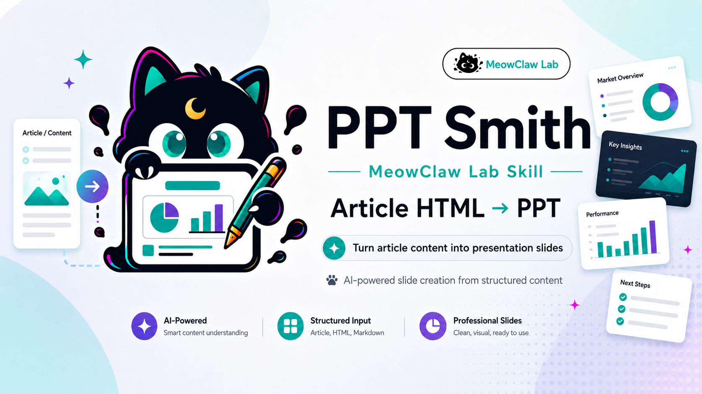

# MeowClaw PPT Smith

<p align="center">
  
</p>

> [中文](README.md) · [Skill entry point](SKILL.md) · [Workflow](references/declarative-design.md) · [Editable sample](assets/samples/v5.1-no-image-policy-native.pptx)

Turn source documents, slide design images, or native PPTX templates into editable presentations with source evidence and real rendered previews. The model develops the narrative and design; a fixed backend creates native objects and checks delivery evidence.

**Current version: `5.2.1`.** Public slug: `meowclaw-pptsmith`. Compatible installation names: `article-html-to-ppt` and `meowclaw-decksmith`. License: Apache-2.0.

## In development: content boundaries from the user's task

This iteration updates onboarding and authoring guidance: identify what must be preserved and what may be analyzed or changed, asking only about consequential gaps. See [user tasks and content boundaries](references/user-task-intent.md). It builds on 5.2.1 and is not a new release; task formats and runtime gates remain unchanged.

## What is new in v5.2.1

- **Three separate review dimensions:** vary body compositions with the content while keeping titles, navigation, type hierarchy and graphic weight consistent. Review variety, coherence and narrative completeness separately.
- **Plan chapters and the ending:** choose contents, section, summary, decision and closing pages for the reporting context, then update pagination and navigation after reordering. Short briefs do not have to add section or thank-you pages.
- **More useful composition diagnostics:** `composition-check` now exposes native body-claim positions/fonts and the declared page-role sequence to locate pages for visual inspection. These observations are not aesthetic scores or semantic acceptance.
- **Lessons from two real revisions:** a new [business report case](references/cases/business-deck-diversity-coherence.md) (Chinese) informs the design guide, page plan and complete-object review guidance. Suspected collisions in thumbnails must be checked on actual pages.

Entry points, task formats and existing warning rules remain compatible; old tasks need no migration. This update improves planning, diagnostics and review. It does not add an automated business-analysis engine or new native chart types. Historical previews and validation records retain their original version labels. A repository version change does not mean installation platforms have published it.

## Start with your actual task

Load the Skill in an agent with the required runtime already configured, attach your material, and describe the outcome. Choose a request close to your situation; no configuration form is needed.

**Make a presentation from approved material:**

```text
Use PPT Smith to turn this approved material into a presentation.
Keep the existing conclusions, figures and metric definitions. You may reorder
the information and shorten repeated wording; preserve marked quotes verbatim.
Follow the attached visual reference. Deliver editable PPTX and actual previews.
```

**Help analyze the material and prepare a presentation:**

```text
Use PPT Smith to prepare a project review from these materials so reviewers
can discuss the next phase. You may organize findings, compare options and
offer supported recommendations. Distinguish source facts from added judgments.
Identify gaps that affect conclusions; do not invent causes, figures or owners.
Deliver editable PPTX and actual previews.
```

**Revise an existing PPT Smith task:**

```text
Continue this PPT Smith task: update slide 4 with the new data and replace
the conclusion on slide 7 with the attached wording. Keep other content and
design unchanged. Check related charts, summaries and pagination; explain
impacts beyond this revision's scope. Deliver the revised PPTX and previews.
```

The revision example requires the original task materials and state; it does not promise lossless editing of arbitrary third-party PPTX files. Uploading material alone does not require every word to remain unchanged. State any required verbatim text, fixed page order or prohibition on additions and deletions so the agent can honor those constraints.

Include any known audience, purpose, duration or slide budget, template and target-software requirements with your material. Language, reporting periods and business definitions are extracted or clarified when relevant, not required for every deck. The agent reads the material first, asks only about gaps that affect correctness or delivery, and handles routing, object descriptions, rendering and checks. Users do not need to author JSON or memorize commands. See [user tasks and content boundaries](references/user-task-intent.md).

First use requires a local-tool-capable agent, Python dependencies, an office renderer and fonts; see [Installation](#installation-and-local-checks) and [more usage examples](#how-to-use-it-with-an-agent).

<details>
<summary>Example: a management presentation from operating data</summary>

```text
Use PPT Smith to create about 15 slides for a monthly business review
from the attached operating data and business notes.
Audience: management. Explain target gaps, sources of change and decisions needed.
Use restrained, orderly consulting-style communication: conclusions first,
with body layouts chosen for the content.
Preserve metric definitions and sources, identify missing information,
and distinguish possible causes from established facts.
Check material gaps before authoring. Deliver editable PPTX and actual previews.
```

Business analysis is one possible use case; consulting-style communication organizes conclusions and evidence; data visualization expresses comparisons, trends, composition and contribution. The existing workflow can produce such reports, but quality depends on source material, the model and actual review. “Consulting-style” does not imply an official consulting-firm template or quality certification.

</details>

<details>
<summary>v5.2.0 recap: decorative business design and whole-deck refinement</summary>

## What is new in v5.2.0

- **Optional `decorative_business` review profile:** plan each page's content relationship, reading path, information-bearing graphics, and layers for the main claim, supporting evidence, and detail.
- **Composition diagnostics:** `composition-check` summarizes declared layouts and flags repeated sequences or a dominant structure for inspection. It does not score aesthetics or certify originality.
- **Independent whole-deck review:** when the profile is enabled, inspect the final assembled deck for rhythm, content-to-graphic relationships, and visual hierarchy as well as reviewing individual pages. Review evidence is bound to the candidate build and content/design hashes; inheriting unchanged-page evidence never inherits the whole-deck verdict.
- **Design and refinement guidance:** practical steps address recolouring without redesign, dense decks reduced to tables, and large decorative shapes with disconnected text.

**The three entry points remain `create`, `recreate`, and `template`.** Add `--review-profile decorative_business` when initializing a decorative business task. Existing tasks that do not enable the profile retain their original contract and do not need new composition fields. Users can describe the desired style to their agent; they do not need to author JSON. Historical examples retain their original version labels and object counts.

</details>

## Gallery: 22-slide Xiaomi business review

**2026-10-18 · Decorative business design.** The user-supplied Xiaomi Q2/H1 2025 report and data sheet became a 22-slide presentation through real rendering, revisions, and independent agent review. Click the image for the full preview.

[](assets/samples/v5.2-xiaomi-q2-h1-22page-overview.png)

<details>
<summary>Version and validation scope</summary>

The experiment used development commit `af23320`, whose version file still read `5.1.1`. Those changes are now included in `5.2.0`; the historical run has not been relabelled as a test of the final release. The PPTX contains 370 text objects, 139 shapes/paths, 6 native charts and 4 native tables: 519 native objects and no images.

On Linux + LibreOffice, sampled text and table edits persisted after saving and reopening. In-application chart-data editing was not successfully validated, and PowerPoint/WPS was not tested. Alibaba PuHuiTi fonts are not embedded. Only the overview image is distributed here; raw inputs, full logs and evidence packages remain outside the public repository.

</details>

## Three ways to use it

| Your task | Input | Route and result |
| --- | --- | --- |
| Turn a report, policy document, PRD, or article into a presentation | Source material; optional brand or style references | **create**: design for the content and audience, then produce native PPTX and real previews |
| Reconstruct a designer's complete slide images | Full slide designs; source documents for checking text and numbers | **recreate**: rebuild editable objects and review against the approved target |
| Use a company or client template | Native PPTX template and source material | **template**: reuse native components and fill gaps using the template's visual rules |

A style reference usually belongs to create; faithful reconstruction of complete pages belongs to recreate. Native templates use the separate Template workflow. Source page count does not determine slide count.

**The visual style is not fixed.** Typography, palette, composition, charts, and page rhythm follow the current content, audience, and brand constraints. Reusable styles, source references, and decorative symbols reduce repetition without imposing one page layout.

**Decorative business reports.** The optional `decorative_business` review profile records each page's content relationship, reading order, information-bearing graphics and visual layers, then requires an independent whole-deck composition review. Diagnostics flag declared repetition for inspection; they do not score aesthetics or certify originality. See the [design guide](references/decorative-business-design.md), [planning sheet](templates/decorative-page-plan.md), and [37-page refinement case](references/cases/decorative-business-refinement.md) (Chinese). The case documents design practice in a separate authoring environment, not an end-to-end certification of that PPTX by this engine.

The [two-round business report case](references/cases/business-deck-diversity-coherence.md) (Chinese) addresses a different failure: greater layout variety can weaken visual order, while a deck can still lack chapter transitions and a real ending. Keep stable deck conventions separate from variable body structures, and review variety, coherence and narrative completeness independently. `composition-check` also exposes native body-claim positions/fonts and the declared contents/section/closing sequence as inspection aids. It does not judge aesthetics or require every short brief to add navigation pages. Existing entry points and task fields remain compatible; old tasks need no migration.

## Design previews without an image-generation model

The default original-design workflow is:

```text
Full source → content and evidence → structured design
→ native editable PPTX → LibreOffice PDF → PNG previews
→ independent visual review and revisions → edit/save/reopen checks → delivery
```

A model that understands images and writes text can describe layouts and inspect programmatic renders. It does not need to generate bitmap images itself. This workflow creates an internal native candidate before producing its design preview. Image generation remains optional for illustrations or an explicitly requested external design target.

| Available capability | Supported workflow |
| --- | --- |
| Vision, no image generation | Create original slides, reconstruct supplied designs, inspect actual previews |
| Vision and image generation | Add independent image assets when needed |
| Text-only model | Author structured designs; use another visual reviewer or a human for image understanding and independent visual acceptance |
| No office renderer | Prepare content and design, then install rendering tools before final delivery |

Photography and complex illustration still require suitable assets. The declarative entry point does not accept arbitrary HTML/CSS, SVG, or model-authored scripts, and does not promise lossless reconstruction of every reference. Recoverable chart/table data stays native; a replaceable image does not make its internal elements editable.

## v5.1 example: six Chinese slides, no image generation

An independent author used the current Skill and a seven-page user-provided PDF, *AI SME Entrepreneurship Support Plan (2026–2028)*, to create a six-slide Chinese overview without image-generation calls. Every slide includes speaker notes and source references. The 90-day action sequence is explicitly labeled as an author recommendation.

Download the same [editable PPTX](assets/samples/v5.1-no-image-policy-native.pptx), or inspect the [object counts and acceptance evidence](assets/samples/v5.1-no-image-policy-evidence.json). These images are unmodified previews rendered from that PPTX.

### Cover: 13 text objects and 6 native shapes


### Targets: 16 text objects and 3 native shapes


### Actions: 18 text objects and 5 native shapes


Counts come directly from the delivered PPTX. Each text box or shape is counted once:

| Slide | Native text | Native shapes | Editable objects |
| --- | ---: | ---: | ---: |
| 1 · Policy overview | 13 | 6 | 19 |
| 2 · Three-year targets | 16 | 3 | 19 |
| 3 · Resource supply | 15 | 4 | 19 |
| 4 · Enterprise development | 12 | 3 | 15 |
| 5 · Open source and support | 20 | 5 | 25 |
| 6 · Author recommendations | 18 | 5 | 23 |
| **Total** | **94** | **26** | **120** |

This example contains **0 images, 0 native charts, 0 native tables, and 0 groups**, with notes on all six slides. Numbers are editable text; they are not counted as charts. Decorative lines and dots count as shapes. Characters and notes placeholders are not counted again. Object count describes editability, not design quality.

The candidate passed independent review of all pages and source content, reaching `final_delivery_ready`. On **macOS with LibreOffice 26.2.4.2**, Basic/UNO changed text, numeric text, and a shape fill on a disposable copy. Saving, closing, and reopening preserved the edits and all six notes; the original candidate stayed unchanged. This is an actual application-object edit test, not GUI clicking, and does not establish Windows/Linux or PowerPoint/WPS compatibility. The sample uses Arial Unicode MS without font embedding; verify fonts and layout on another device.

## Retained v5.0 example: a 20-slide Chinese research overview

A 67-page report, *Agents, robots, and us: How AI reshapes work and skills in Latin America*, became a 20-slide Chinese overview covering automation potential, economic value, jobs and skills, country comparisons, and business cases. All 20 slides have sources and speaker notes. This is the original v5.0-era output, counted separately from the v5.1 example above.

The workflow was source document → complete slide design images → multimodal interpretation and declarative reconstruction → native PPTX → real rendering and acceptance. The original contact sheet is preserved below. [Download the original editable PPTX](assets/samples/v5.0-latin-america-ai-zh-native.pptx) or inspect [per-slide object data](assets/samples/v5.0-latin-america-ai-zh-evidence.json).


| Object type | Count | Editing scope |
| --- | ---: | --- |
| Native text boxes | 274 | Text, font, size and colour |
| Native shapes and paths | 164 | Position, size and colour |
| Native charts | 7 | Editable data series with 7 embedded workbooks |
| Native tables | 2 | Cells, rows, columns and styling |
| **Native editable objects** | **447** | **274 + 164 + 7 + 2** |
| Separate cover image | 1 | Replace as a whole; illustration elements are not individually editable |
| **Total slide objects** | **448** | **447 native objects + 1 image** |

Counts are read directly from the original PPTX. Each object is counted once; chart points, table cells, embedded workbooks and notes are not counted again.

<details>
<summary>Show all 20 slides' object counts</summary>

| Slide | Text | Shapes/paths | Charts | Tables | Native editable | Replaceable images |
| --- | ---: | ---: | ---: | ---: | ---: | ---: |
| 1 | 7 | 2 | 0 | 0 | 9 | 1 |
| 2 | 15 | 18 | 0 | 0 | 33 | 0 |
| 3 | 19 | 6 | 0 | 0 | 25 | 0 |
| 4 | 13 | 5 | 1 | 0 | 19 | 0 |
| 5 | 14 | 7 | 1 | 0 | 22 | 0 |
| 6 | 9 | 3 | 1 | 0 | 13 | 0 |
| 7 | 9 | 3 | 1 | 0 | 13 | 0 |
| 8 | 16 | 10 | 0 | 0 | 26 | 0 |
| 9 | 11 | 5 | 0 | 1 | 17 | 0 |
| 10 | 13 | 8 | 1 | 0 | 22 | 0 |
| 11 | 9 | 3 | 1 | 0 | 13 | 0 |
| 12 | 12 | 5 | 1 | 0 | 18 | 0 |
| 13 | 15 | 9 | 0 | 0 | 24 | 0 |
| 14 | 7 | 3 | 0 | 1 | 11 | 0 |
| 15 | 20 | 9 | 0 | 0 | 29 | 0 |
| 16 | 15 | 6 | 0 | 0 | 21 | 0 |
| 17 | 16 | 13 | 0 | 0 | 29 | 0 |
| 18 | 20 | 9 | 0 | 0 | 29 | 0 |
| 19 | 17 | 28 | 0 | 0 | 45 | 0 |
| 20 | 17 | 12 | 0 | 0 | 29 | 0 |
| **Total** | **274** | **164** | **7** | **2** | **447** | **1** |

</details>

Historical acceptance used macOS + LibreOffice 26.2.4.2 through Basic/UNO to edit text, chart data, table data and the cover image on a copy. Changes persisted after saving, closing and reopening. Reconstruction retains differences in fonts, icons, gradients and chart styling; pixel-perfect 1:1 fidelity is not claimed. PowerPoint/WPS was not tested. Hiragino Sans GB and Arial are not embedded; recheck fonts and layout on another device.

## How to use it with an agent

Load this directory's [SKILL.md](SKILL.md) in a host that can read Skills and execute local tools. Supply the source and intended outcome. Users do not need to write object JSON themselves.

**From a document, without image generation:**

```text
Use PPT Smith to turn this PDF into about 10 editable Chinese slides.
Audience: SME leaders. Goal: understand the policy and identify useful actions.
The model has vision but no image-generation tool.
Choose a visual style for the content. Preserve numeric qualifiers,
page-level sources and speaker notes. Label author advice separately.
Deliver after real rendering, independent review, and target-software edit/save/reopen checks.
```

**For a decorative business report:**

```text
Use PPT Smith to turn this business report into about 20 editable Chinese slides.
Enable the decorative_business review profile. Plan each page's main claim,
content relationship and reading path before choosing its visual structure.
Use suitable expressions for target attainment, progress, issues and actions,
and major results. Review representative pages before expanding the deck.
Deliver after real rendering, independent page and whole-deck review,
and target-software edit/save/reopen checks.
```

**From complete design images:**

```text
Use these complete slide designs as reconstruction targets and the PDF
as evidence for text and numbers. Preserve the approved layout.
Identify conflicts that need correction. Keep text and recoverable chart/table data native.
Explain image and effect limitations and provide target/actual preview comparisons.
```

**From a native template:**

```text
Use this company PPTX template for a 15-slide Chinese report.
Reuse native components, preserve brand fonts and colours, and include sources and notes.
Adapt page structure where content does not fit, explain the changes,
and verify editing and saving in the target software.
```

**For a small revision:**

```text
Use the previous task. Change only the title on slide 6 and the notes on slide 7.
Apply object patches and review affected pages again.
Reuse unchanged-page review only through the verified inheritance mechanism.
```

Specify audience, purpose, language, slide budget, target software, and whether reference images express style or exact reconstruction. For revisions, retain the task directory and identify the affected pages/objects so the agent can load only the relevant context.

## Less repeated input and rework

- **Load instructions as needed:** the Skill entry keeps shared rules; route details load when selected.
- **Compact authoring:** reusable styles, sources, colour values, and symbols expand into strict native objects.
- **Short feedback:** build summaries point to complete evidence; content and objects can be inspected by page.
- **Real font preflight:** test office-rendered fonts and characters before expanding a large deck, with environment-bound caching.
- **Guarded patches and review inheritance:** revise objects without rewriting the task. Notes or data changes invalidate relevant review even when pixels stay the same.

Measurements for the same six-slide task, with exact semantic round-trip validation:

| Measurement | Original/full bytes | New/compact bytes | Reduction |
| --- | ---: | ---: | ---: |
| Skill entry at v5.1 development acceptance, compared with v5.0.1 | 14,384 | 6,278 | 56.4% |
| Author input for the same task | 69,702 | 42,808 | 38.6% |
| CLI feedback for the same build | 24,550 | 631 | 97.4% |

These are UTF-8 byte counts, using identical canonical JSON encoding for task input. The [sample evidence](assets/samples/v5.1-no-image-policy-evidence.json) records the scope. **They are not measured token, billing, or runtime savings.** Full source, object, build, and review evidence remains on disk. Revisions still build and render the whole deck; inheritance reduces repeated review, not rendering work.

## Installation and local checks

Install Python dependencies from the Skill root. Bash example for macOS/Linux:

```bash
python3 -m venv .venv
source .venv/bin/activate
python -m pip install -r requirements.txt
python scripts/check_identity.py
python scripts/quick_validate_skill.py
python -m engine design capabilities
```

Real previews and font probes also require **LibreOffice, Poppler (pdftoppm, pdffonts, pdftotext), Fontconfig (fc-match), and the selected fonts**. Tools must be discoverable through PATH. On Windows use the corresponding virtual-environment Python executable; see [platform requirements](references/declarative-design.md#跨平台运行条件). `capabilities` checks local tools, not the host model's vision or image-generation capabilities.

The following illustrates the agent workflow. The model writes `author.json` from the source into the task directory; `init` does not parse a PDF or design slides by itself:

```bash
PPTSMITH_TASK="./ppt-work/demo"
python -m engine design init --task-dir "$PPTSMITH_TASK" --task-id demo --mode create --pages 6
python -m engine design author --task-dir "$PPTSMITH_TASK" --file author.json
python -m engine design preflight --task-dir "$PPTSMITH_TASK" --isolation auto
python -m engine design build --task-dir "$PPTSMITH_TASK" --isolation auto
```

A successful build is a candidate. Use its build ID to prepare the review, complete independent review and actual editing checks, then run `review` and `deliver`. `state.json` records continuation details; the task, build manifest, and original review retain full evidence. See [the workflow](references/declarative-design.md) and [compact authoring/revisions](references/declarative-authoring.md).

Only compatibility builders using PptxGenJS require Node/npm plus:

```bash
python scripts/bootstrap_pptxgenjs_runtime.py
```

The script runs lockfile-pinned `npm ci` inside `runtime/pptxgenjs`.

## Delivery and compatibility boundaries

Final delivery includes editable PPTX, actual PDF/PNG previews, task and asset records, object inventory, review decisions, and editing limitations. Text, shapes, and recoverable data remain native wherever supported. An unapproved whole-slide screenshot cannot stand in for an editable deck.

Quality acceptance and OS isolation are separate. `--isolation auto` selects macOS isolation where available and host execution elsewhere. Host execution can deliver after quality checks, with OS isolation recorded as unverified. Explicit `--require-os-isolation` still blocks when isolation is unavailable. Runtime adapters do not establish actual application parity across operating systems.

Native template preservation continues through [Template](references/routes/v4-template-route.md). Bespoke is an advanced compatibility route; Standard/Engineering serves explicit engineering drafts and diagnostics. New `new_design` and `style_transfer` initializations map to create, while saved legacy tasks retain their original target requirements. A restricted browser design board, template-index cache, and measured model-cost dashboard are not included in this version.

## Historical examples

These are real renders from earlier versions and are not part of the v5.1 object counts above.

<details>
<summary>Show V4 Template and Bespoke examples</summary>

**Template: a 31-slide research presentation**, with notes on 29 body slides, using a source report and native template components.


**Bespoke: a 23-slide independent presentation**, with 12 native charts and notes on all 23 slides. These examples use different reports and are not a controlled quality comparison. They do not imply partnership, authorization, or endorsement by report publishers or template brands.


More historical assets are in the [sample directory](assets/samples/).

</details>

## Documentation and distribution

- [Skill execution contract](SKILL.md)
- [Declarative workflow, native objects, and acceptance](references/declarative-design.md)
- [Compact authoring, object patches, and review inheritance](references/declarative-authoring.md)
- [Template reuse](references/routes/v4-template-route.md) · [Bespoke compatibility](references/routes/v4-bespoke-route.md)
- [V4 route architecture](references/routes/v4-three-route-architecture.md) · [Historical export capabilities](references/export-pipelines.md)
- [Sample evidence](assets/samples/v5.1-no-image-policy-evidence.json)

Public distributions on GitHub, ClawHub and similar platforms contain Skill runtime code, dependency declarations, usage documentation, templates/schemas, and the referenced examples with supporting data. Development tests, CI, development notes, promotional articles, raw inputs, full acceptance logs, temporary outputs and local worktrees remain outside the public version.

Local building and rendering do not publish files. Source handling by the model depends on the host configuration. Feishu/Lark creation, upload, or sharing requires user authorization for that delivery.

The core engine, general components, editable objects, and QA are open source under Apache-2.0. Enterprise brand adaptations, dedicated masters, industry packages, custom components, and managed generation/deployment services are separate commercial deliverables, excluded from the public repository and Skill bundle.
