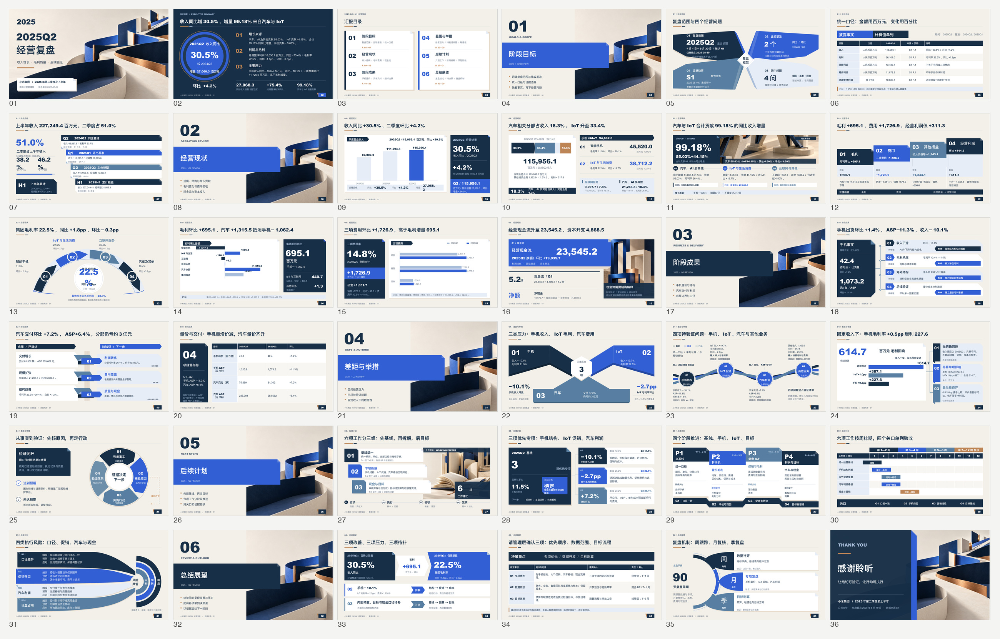
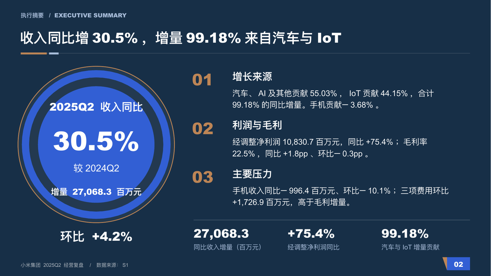
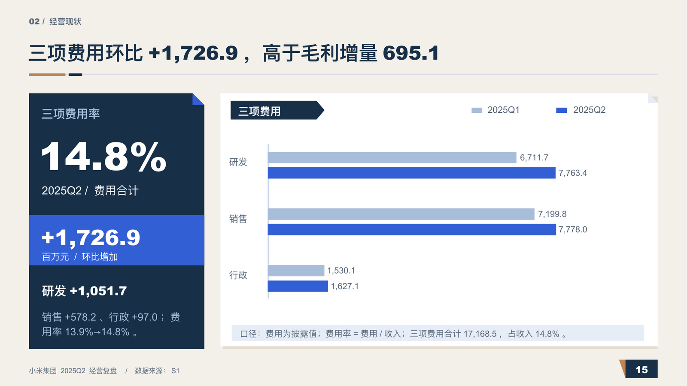
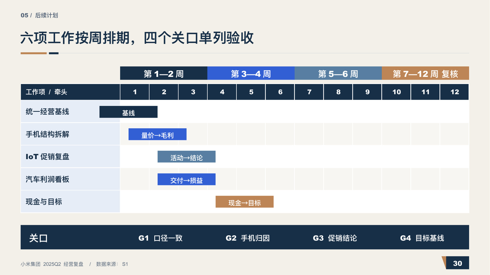
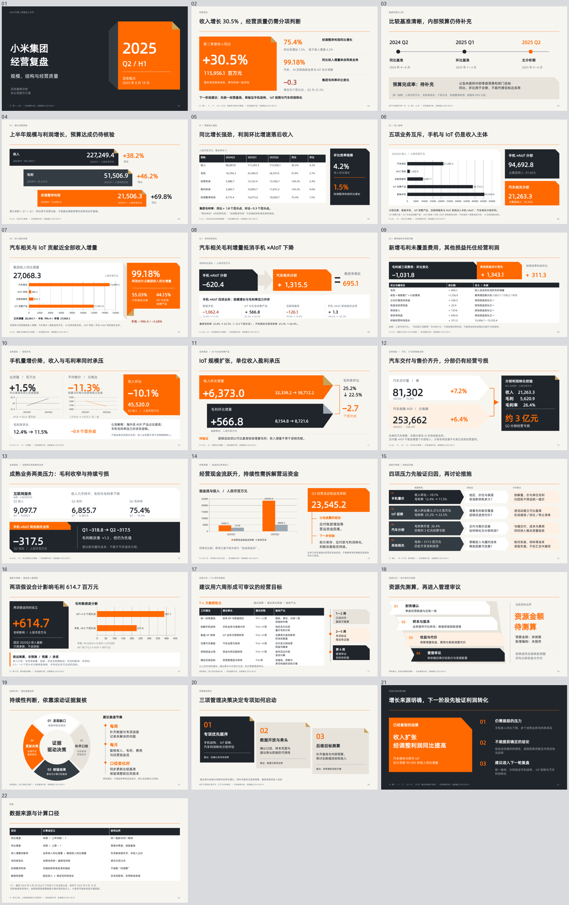
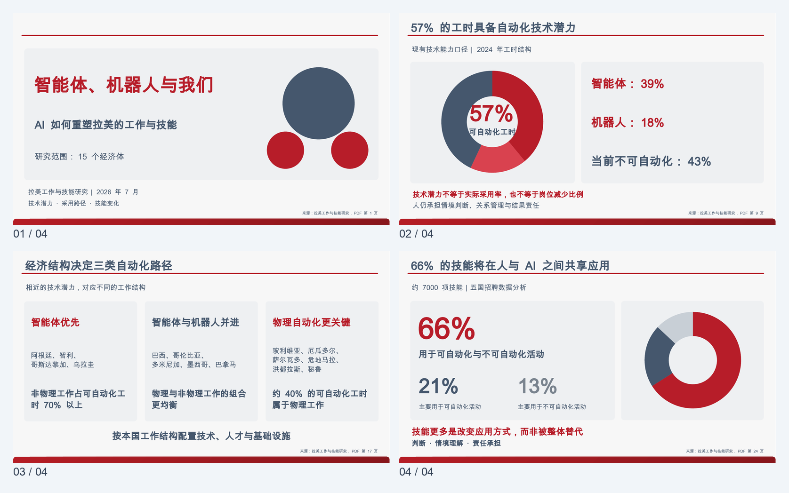

# PPT Smith

<p>
  <a href="https://ppt.skillmelody.com"></a>
  <a href="https://chromewebstore.google.com/detail/ppt-smith-%C2%B7-source-basket/ndmjfdmpgghcgpbidcloljomlmkfngab"></a>
  <a href="https://www.youtube.com/watch?v=_I2oauMIwnM"></a>
  <a href="SKILL.md"></a>
  <a href="LICENSE"></a>
</p>

[简体中文](README.md) · [Web App](https://ppt.skillmelody.com) · [Chrome Extension](https://chromewebstore.google.com/detail/ppt-smith-%C2%B7-source-basket/ndmjfdmpgghcgpbidcloljomlmkfngab) · [Demo Video](https://www.youtube.com/watch?v=_I2oauMIwnM) · [Skill Entry](SKILL.md) · [Installation](#installation-and-local-checks) · [Contact](#contact--feedback)

**Turn source documents, web clippings, approved slide designs or native PPTX templates into presentations with traceable content, editable objects and real previews.**  
The model owns narrative and design; fixed tools execute, compile and verify.

> **Current version: `5.4.0` · Apache-2.0.** Install as `article-html-to-ppt`; public slug `meowclaw-pptsmith`; compatibility alias `meowclaw-decksmith`.

---

## Three Ways to Use PPT Smith

| Surface | Best for | What it does | Link |
| :--- | :--- | :--- | :--- |
| **🌐 Web App** | Zero-setup slide creation in the browser | No local Python/LibreOffice setup needed; upload materials or send clips from the browser extension, pick curated templates or upload your own PPTX, review the outline and export editable slides | [ppt.skillmelody.com](https://ppt.skillmelody.com) |
| **🧩 Chrome Extension (Source Basket)** | Collecting research snippets and visuals while browsing | Capture full pages (including WeChat articles), right-click text clippings and drag-select poster/chart screenshots; **local-first storage** with one-click ZIP export or direct handoff to the web app | [Chrome Web Store](https://chromewebstore.google.com/detail/ppt-smith-%C2%B7-source-basket/ndmjfdmpgghcgpbidcloljomlmkfngab) · [Offline ZIP 0.1.5](pptsmith-browser-extension-0.1.5.zip) |
| **⚙️ Open-Source Agent Skill (This Repo)** | Power users & teams running Claude Code, Codex, OpenClaw or Cursor | Fully auditable local pipeline: HTML-to-native PPTX compilation, industry/brand visual grounding, original-page template editing, whole-deck structural diagnostics and real LibreOffice rendering | [SKILL.md](SKILL.md) · [Installation](#installation-and-local-checks) |

---

## Extension & Web App Demo (PPT Smith · Source Basket)

Click the thumbnail below to watch the **37-second demo on YouTube** — clipping text and posters from a web page, exporting a local ZIP source pack, or sending materials straight into `ppt.skillmelody.com` to build slides with a template:

[](https://www.youtube.com/watch?v=_I2oauMIwnM)

- **Three capture modes**: one-click full-page capture (including WeChat articles from the side panel), right-click text clipping, and drag-box region screenshots for posters/charts.
- **Local-first privacy**: all clipping and ZIP exports run locally; collected materials stay on your machine until you explicitly choose **Send to Website**.
- **Two seamless outputs**:
  - **Export Source Pack (ZIP)**: bundles structured Markdown clippings and screenshots ready for your local Agent + PPT Smith Skill.
  - **Send to Website**: hands off clippings and screenshots directly to [ppt.skillmelody.com](https://ppt.skillmelody.com) for either **Template Mode** (curated library or your own PPTX) or **Content Generation** (outline review before slide creation).
- **Install & upgrade**: install directly from the [Chrome Web Store](https://chromewebstore.google.com/detail/ppt-smith-%C2%B7-source-basket/ndmjfdmpgghcgpbidcloljomlmkfngab). For Edge or offline installation, download [pptsmith-browser-extension-0.1.5.zip](pptsmith-browser-extension-0.1.5.zip) (to upgrade while keeping your local basket, extract over the previous folder and click **Reload** in your browser's extensions page).

---

## Showcase

### Template-route result · Xiaomi Group Q2/H1 2025 business review · 36 slides

From the executive summary and operating drivers to validation questions, action planning and management decisions, the deck retains a coherent template language. The overview below comes from the user-supplied PPTX rendered by an actual office engine, not a redrawn promotional image. Click to enlarge.

[](assets/samples/v5.3-xiaomi-2025-q2-h1-template-36page-overview.jpg)

<table>
  <tr>
    <td width="33%"><a href="assets/samples/v5.3-xiaomi-template-page-02.jpg"></a><br><strong>Executive summary</strong><br>Metrics and conclusions in distinct layers</td>
    <td width="33%"><a href="assets/samples/v5.3-xiaomi-template-page-15.jpg"></a><br><strong>Expense comparison</strong><br>Data grouped with its interpretation</td>
    <td width="33%"><a href="assets/samples/v5.3-xiaomi-template-page-30.jpg"></a><br><strong>Action schedule</strong><br>From conclusions to execution</td>
  </tr>
</table>

<details>
<summary>Object inventory and validation scope</summary>

- **36 actual 16:9 slides**, with nonempty speaker-note bodies on all 36; LibreOffice rendered **36/36 successfully**.
- 1,398 top-level objects: 1,383 native shapes, including 772 nonempty text frames, plus 4 native tables and 11 picture objects. Text frames are a subset, not an additional count.
- This deck has **no data-backed native charts or embedded chart workbooks**. Visible bars and rings are native drawing shapes, not chart-data editing capability.
- This is a user-supplied finished template-route result. This release checked the file, rendered it and inspected representative pages; it **did not repeat the complete generation run** or certify it as an end-to-end v5.3.0 run.
- Original local line-break and annotation-spacing imperfections remain. Financial facts were not re-audited; PowerPoint/WPS GUI edit-save-reopen was not tested.
- Only this overview, three representative images and [concise evidence](assets/samples/v5.3-xiaomi-template-evidence.json) are public. The original PPTX, inputs and complete logs are excluded.

</details>

### More real examples

<table>
  <tr>
    <td width="33%"><a href="assets/samples/v5.2-xiaomi-q2-h1-22page-overview.png"></a><br><strong>22-slide business review</strong><br>Body-layout variety and deck coherence</td>
    <td width="33%"><a href="assets/samples/v5.1-template-native-4page-2col-overview.png"></a><br><strong>Native component reuse</strong><br>Four-slide same-source comparison</td>
    <td width="33%"><a href="assets/samples/v5.1-no-image-policy-page-01.png"></a><br><strong>No-image-generation design</strong><br>Six Chinese policy slides with actual previews</td>
  </tr>
</table>

Earlier examples retain their original versions and evidence limits; see the [historical gallery](references/cases/legacy-showcase.en.md). Counts and version labels are not aesthetic scores or general compatibility certification.

---

## Key Capabilities: 5.4.0 HTML Design Surface & Deck Guardrails

- **Design in a browser, deliver 100% native objects.** `create` defaults to a restricted HTML/CSS surface so the model leverages real Flex/Grid layout and text measurement. `engine design html-import` extracts computed geometry and compiles editable text, shapes, freeform paths, native tables, native charts and replaceable `data-asset` pictures. HTML and scripts never enter the PPTX.
- **Industry & brand-grounded visual system.** Typography, palette, density and layout language adapt to the deck's industry and audience instead of a one-size-fits-all template. When sources carry an explicit brand (e.g., consulting reports, company earnings, product launches), the workflow extracts brand visual traits from the source material first — never fabricating unprovided logos.
- **Traced content, not wishful thinking.** Import creates provenance-bound records, verifies that on-slide text, table cells and raw chart numbers come from the source, separates authored wording/derived values/navigation labels, and reports missing source numbers.
- **Import-time lint & whole-deck structural diagnostics:**
  - `design_lint` blocks text overlap, container/box overflow, out-of-slide elements and **mixed incompatible units on single-axis charts (`CHART_MIXED_UNITS`, e.g., GW and % on one axis)**, while flagging missing CJK fonts, small text and flat hierarchy.
  - `composition-check` flags whole-deck narrative defects: **inconsistent section divider themes, missing Chapter 1 lead-in dividers, TOC-vs-divider count mismatches and divider-vs-eyebrow numbering conflicts**.
  - Lightweight metadata/page maintenance (`set-meta`, `set-page`, `add-page`, `remove-page`, `reorder-pages`) plus page-scoped LibreOffice font preflight.
- **5.3.0 original-page template workflow.** Clones real source slides with masters, themes and native relationships intact; edits text, supported chart/table data, order and notes through atomic Python transactions without smuggling unselected slides.

---

## Three Agent Skill Routes

| Task | Input | Route |
| :--- | :--- | :--- |
| Make a presentation from a report, policy, PRD, article, basket ZIP or data | Source material; optional brand/style references | **create**: HTML design surface compiled to native pages, then rendered and reviewed |
| Rebuild an approved complete slide design | Full-page designs and checked source text/data | **recreate**: native reconstruction against a frozen target |
| Preserve a company/client PPTX template | Native template and current content | **template**: original-page editing; retain Atlas for existing component tasks |

A template used only as a style reference belongs to `create`. Native asset preservation belongs to `template`. Source page count does not prescribe slide count; long multi-chapter reports should budget enough slides so chapters stay balanced.

**Image generation is optional.** A vision-capable model can author native objects and inspect real renders. Generated illustrations or an explicitly approved external design target are optional; a text-only model still needs a human or vision reviewer for visual acceptance.

---

## How to Use the Skill with an Agent

Load [SKILL.md](SKILL.md), attach your material (document, outline or exported Source Basket ZIP) and specify the audience, goal, language, slide budget and target software. Users never need to hand-write JSON or HTML.

**Design from sources (default HTML surface):**

```text
Use PPT Smith to create an editable executive presentation from this material.
Lead with conclusions, ground the visual system in the source's industry and brand traits,
vary body layouts to fit information relationships, and keep chapter numbering consistent.
Do not invent missing numbers; separate facts, derived values and recommendations;
retain page sources and notes. Image generation is not required.
Deliver the editable PPTX, actual previews, review results and material editing limits.
```

**Reuse a native company template:**

```text
Use PPT Smith to create about 20 slides from this company PPTX template
and the attached business material. Audience: management.
Lead with conclusions, then explain changes and decisions.
Retain the original-page visual language, master and layouts; select, copy and
adapt pages to the content rather than copying the template's sample text.
Preserve important numbers, definitions, sources and notes.
Check representative pages before expanding the deck, render actual PPTX pages,
obtain independent review and disclose chart/image/application editing limits.
```

For reconstruction, supply approved full-page targets. For targeted revisions, keep the task directory and specify affected pages/objects. Both routes inherit unchanged, previously passing page observations only via explicit `review-template --inherit-from`; modified pages and whole-deck rhythm are always reviewed afresh.

---

## Installation and Local Checks

From the Skill root, using Bash on macOS/Linux:

```bash
python3 -m venv .venv
source .venv/bin/activate
python -m pip install -r requirements.txt
python scripts/check_identity.py
python scripts/quick_validate_skill.py
python -m engine design capabilities
python -m engine template capabilities
```

Real previews and the HTML design surface require **LibreOffice, Poppler, Fontconfig, actual fonts and Chrome / Chromium Headless Shell** (override with `PPTSMITH_BROWSER` if needed). Capability discovery checks local tools, not the host model's vision or image-generation abilities.

- The original-page template executor requires **POSIX `fcntl` and `O_NOFOLLOW`** (verified on macOS; Windows unsupported). Source and output decks are each limited to 100 slides.
- See the [declarative workflow](references/declarative-design.md) for cross-platform `create`/`recreate` requirements.
- Only PptxGenJS compatibility builders require Node/npm and `python scripts/bootstrap_pptxgenjs_runtime.py`; both the default HTML surface and the original-page template workflow add no Node dependency.

---

## Delivery and Compatibility Boundaries

| Area | Current boundary |
| :--- | :--- |
| New chart editing | Single-plot category charts with real data/workbooks; single-axis charts forbid mixed units |
| Tables | HTML surface supports merged cells and per-cell styles; original-page template edits existing unmerged rectangular cells |
| Pictures | HTML surface embeds replaceable registered assets (`data-asset`); original-page template clones embedded same-source pictures |
| Preservation & lint | Source preservation, structural diagnostics and type-scale floors assist review; they are not aesthetic scores |
| Review | Bound to current candidate, template and actual page images; reviewer identity is declared, not authenticated |
| Office applications | Native objects and LibreOffice rendering do not prove PowerPoint/WPS GUI edit-save-reopen compatibility |

Final delivery includes editable PPTX, real previews, source/gap records, review decisions and editing limitations. An unapproved whole-page screenshot cannot substitute for editable reconstruction. Business/scientific facts still require checking. Model-side source handling depends on the host; local tools do not mean model calls are necessarily offline.

Quality and OS isolation are verified separately; explicit isolation requirements remain binding. Bespoke is an advanced compatibility route; Standard/Engineering is only for explicit engineering drafts and diagnostics.

---

## Documentation and Distribution

- **Core contracts**: [Skill entry](SKILL.md) · [HTML design surface](references/html-design-authoring.md) · [Original-page template workflow](references/native-template-workflow.md)
- **Authoring & inputs**: [Declarative design & acceptance](references/declarative-design.md) · [Compact authoring & revisions](references/declarative-authoring.md) · [Outline-to-deck authoring](references/outline-to-deck.md)
- **Advanced layouts & templates**: [Decorative business design](references/decorative-business-design.md) · [Page planning sheet](templates/decorative-page-plan.md) · [Template-inspired design](references/template-visual-design.md) · [Existing template component workflow](references/routes/v4-template-route.md)
- **Evidence & packaging**: [Historical examples & evidence limits](references/cases/legacy-showcase.en.md) · [Public bundle scope](references/BUNDLE-MANIFEST.md)

The GitHub repository ([SkillMelody/PPT-Smith](https://github.com/SkillMelody/PPT-Smith)) retains source code, showcase previews, offline extension archives and focused regressions. Lightweight ClawHub/SkillHub runtime packages exclude tests, extension ZIPs, `assets/samples/`, `assets/branding/` and private material via `.clawhubignore`.

---

## Contact & Feedback

If a generated deck looks off or a workflow feels stuck across the web app, browser extension, or Agent Skill, it is often a case of **"使用姿势不对"** (*our house phrase for usage/prompt/workflow issues*).

Reach out anytime to troubleshoot usage issues, report bugs, suggest features, or discuss enterprise template work:

- **Email**: [melody@skillmelody.com](mailto:melody@skillmelody.com)
- **GitHub Issues**: [SkillMelody/PPT-Smith/issues](https://github.com/SkillMelody/PPT-Smith/issues) (best for reproducible logs and usage troubleshooting)
- **WeChat Official Account (公众号)**: Search `夜猫子弦月`
- **Zhihu (知乎)**: Official articles, Q&A, and usage discussions
- **X (Twitter)**: Release updates and community discussion

Maintained by **MeowClaw Lab / SkillMelody**. The core engine, general components and QA use **Apache-2.0**. Brands and examples imply no company partnership or endorsement. Enterprise brand adaptations, dedicated masters and managed generation are separate commercial deliveries, not part of the public bundle.
