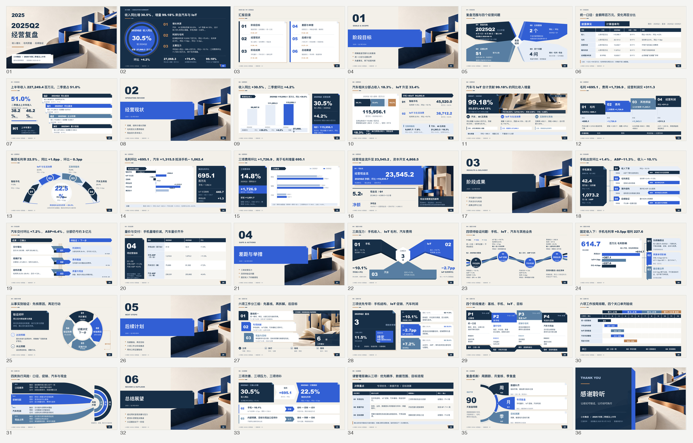
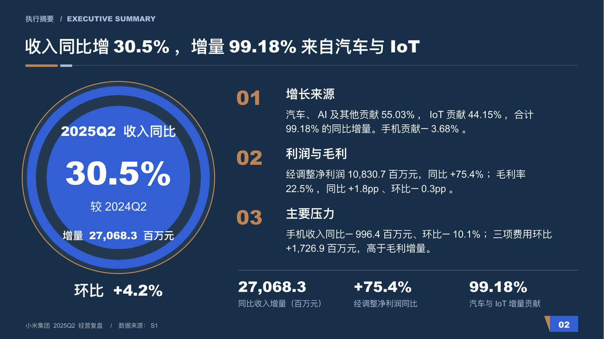
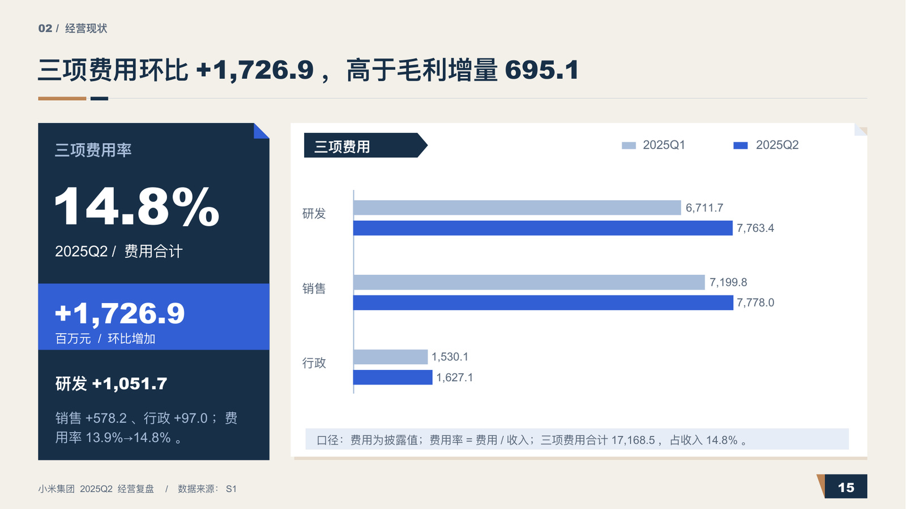
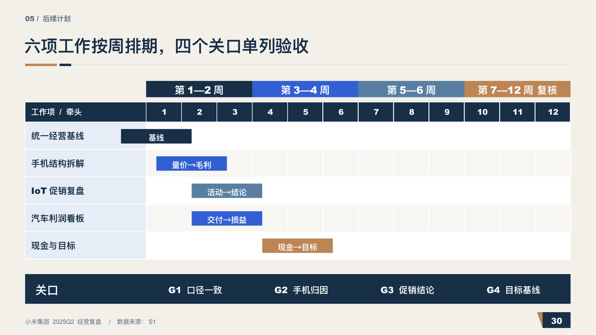

# PPT Smith

[English](README.en.md) · [Skill 入口](SKILL.md) · [原页模板流程](references/native-template-workflow.md) · [安装与自检](#安装与本地自检)

把源文档、设计图或原生 PPTX 模板，转成有来源、可继续修改、具有真实预览的演示文稿。模型负责理解内容与设计，固定工具负责生成、编辑和核验。

**当前版本：`5.3.0` · Apache-2.0。** 安装标识 `article-html-to-ppt`，公开标识 `meowclaw-pptsmith`，兼容别名 `meowclaw-decksmith`。

## 作品展示

### 模板路线实测｜小米集团 2025Q2 及上半年经营复盘 · 36 页

从经营摘要、收入与利润拆解，到问题验证、行动排期与管理层决策，保留统一模板语言和完整汇报结构。下图直接来自用户提供成稿的真实办公渲染，不是宣传重绘图；点击可看完整总览。

[](assets/samples/v5.3-xiaomi-2025-q2-h1-template-36page-overview.jpg)

<table>
  <tr>
    <td width="33%"><a href="assets/samples/v5.3-xiaomi-template-page-02.jpg"></a><br><strong>结论摘要</strong> · 指标与判断分层</td>
    <td width="33%"><a href="assets/samples/v5.3-xiaomi-template-page-15.jpg"></a><br><strong>费用对比</strong> · 数据与解释归组</td>
    <td width="33%"><a href="assets/samples/v5.3-xiaomi-template-page-30.jpg"></a><br><strong>行动排期</strong> · 从判断走向执行</td>
  </tr>
</table>

<details>
<summary>查看这份作品的对象统计与验证范围</summary>

- 实际 **36 页、16:9，36 页备注正文齐全**；本次 LibreOffice 渲染 **36/36 页通过**。
- 顶层对象 1,398 个：1,383 个原生形状（其中 772 个含非空文本），4 个原生表格、11 个图片对象。文本框是形状的子集，不重复相加。
- 本稿**没有原生数据图表或图表内嵌工作簿**；可视条形、圆环等由原生图形表达，不能冒称可编辑图表数据。
- 这是用户提供的模板路线成稿。本轮完成文件核对、真实渲染和代表页目检，**未重新执行其完整生成过程**，不据此标注为本轮 5.3.0 端到端生成认证。
- 原稿局部换行和标注间距问题保留，未为展示重新排版。未复核全部财务事实，PowerPoint/WPS 编辑保存重开未测。
- 仅公开总览、三张代表页及[简要证据](assets/samples/v5.3-xiaomi-template-evidence.json)，不公开原始 PPTX、资料与完整日志。

</details>

### 更多真实作品

<table>
  <tr>
    <td width="33%"><a href="assets/samples/v5.2-xiaomi-q2-h1-22page-overview.png"></a><br><strong>22 页装饰商务汇报</strong><br>正文构图变化与整册一致性</td>
    <td width="33%"><a href="assets/samples/v5.1-template-native-4page-2col-overview.png"></a><br><strong>4 页原生组件复用</strong><br>与模板风格重建设计作同源对照</td>
    <td width="33%"><a href="assets/samples/v5.1-no-image-policy-page-01.png"></a><br><strong>6 页无生图政策解读</strong><br>原生对象设计与实际预览</td>
  </tr>
</table>

历史作品保留原版本与原验证范围，详见[历史画廊与实测说明](references/cases/legacy-showcase.md)。作品数量、对象数量和本轮版本号都不直接代表审美质量或通用兼容性。

## 5.3.0：把原页模板工作流接入 Skill

- **先保留原页，再编辑内容**：输出页绑定真实源页，克隆布局、母版、主题与必要原生关系，不只参考颜色后从白页重画。
- **固定 Python 工具**：原生文字、支持的图表/表格数据、同源样式对象、页序与备注通过明确操作更新；宿主 Agent 负责叙事和工具循环，无需网站账号、第二个模型运行时或新增 Node 依赖。
- **局部修订可接续**：稳定页 ID、revision 检查、冻结模板与原子事务；失败不留下半成品状态，未选择原页不夹带进入输出包。
- **检查绑定当前文件**：模板源资产、装饰与字号底线、真实渲染和独立逐页审核分开执行。机器通过只产生候选，缺失/过期证据不变成正式交付。
- **旧任务保持兼容**：仍只有 `create / recreate / template` 三个入口；Atlas/组件编排继续使用旧合同，不强制迁移旧任务。

新执行器的环境与对象限制见下文。新增作品是成稿检查与展示；模板工具本身的合成回归与渲染验证采用独立测试，不把二者混为同一次验收。

## 三种制作方式

| 你要完成的事 | 输入 | 路线 |
| --- | --- | --- |
| 从报告、政策、PRD、文章或数据制作演示 | 源材料；可选品牌或风格参考 | **create**：按内容设计原生页面，再渲染与审核 |
| 重建已经批准的完整幻灯片设计 | 整页设计图；核对文字数字的材料 | **recreate**：原生重建并对照冻结目标 |
| 保留公司或客户的 PPTX 模板 | 原生模板与本次内容 | **template**：原页克隆编辑；复杂组件任务保留 Atlas 流程 |

模板只作风格参考、允许重新设计时用 create；必须保留原生页面与模板资产时才用 template。资料页数不决定演示页数，配色、字体、构图与节奏按当前受众和内容选择，不固定套同一组卡片。

**没有生图工具也能设计。** 具备视觉理解的模型可以编写原生对象、查看实际渲染并修订；生图仅作为独立插画或经批准外部设计目标的可选能力。只有文本模型时，图像理解与独立视觉审核仍需视觉模型或人工。

## 怎么用：把目标交给 Agent

加载 [SKILL.md](SKILL.md)，提供材料，并说明受众、目的、语言、页数和目标软件。普通用户不用编写对象 JSON。

**使用原生模板：**

```text
使用 PPT Smith，基于这个公司 PPTX 模板和附件经营材料，制作约 20 页中文汇报。
面向管理层，先给核心结论，再解释变化和待决事项。
保留原页视觉语言、母版与布局；按内容选择、复制和调整页面，不照抄模板示例文案。
保留关键数字、口径、来源与讲稿。先做代表页，再完成整稿；
真实渲染后独立审核，说明图表、图片和目标软件的编辑边界。
```

**从资料原创设计：**

```text
使用 PPT Smith，将这份材料做成约 12 页中文可编辑 PPT。
受众是业务负责人，结论先行，构图随信息关系变化，整册保持规整。
不编造缺失数字，区分原文事实、计算与作者建议；逐页保留来源和备注。
不要求生图。交付实际 PPTX、预览、审核结论和重要编辑限制。
```

**还原或修订：**提交已批准的完整设计图并注明需忠实还原；只改少量内容时保留任务目录，指出页/对象和改动。审核复用必须满足各自路线的依赖检查；新原页工具暂不自动继承旧候选审核。

## 安装与本地自检

在 Skill 根目录安装依赖，以下是 macOS/Linux Bash 示例：

```bash
python3 -m venv .venv
source .venv/bin/activate
python -m pip install -r requirements.txt
python scripts/check_identity.py
python scripts/quick_validate_skill.py
python -m engine design capabilities
python -m engine template capabilities
```

真实预览还需要 **LibreOffice、Poppler、Fontconfig 及实际字体**。`capabilities` 检查本地工具，不自动识别宿主模型的识图或生图能力。

- 新原页模板执行器要求 **POSIX `fcntl` + `O_NOFOLLOW`**，本机 macOS 已验证，Windows 不支持；源模板与输出各最多 100 页。
- create/recreate 的运行条件见[声明式工作流](references/declarative-design.md)，不能把新模板执行器的限制套到所有旧路线，也不宣称所有系统已实测。
- 仅使用依赖 PptxGenJS 的兼容构建器时，另需 Node/npm 和 `python scripts/bootstrap_pptxgenjs_runtime.py`。新原页工具无需新增 Node 依赖。

工具流程：`capabilities → init → inspect → apply → export → render → review → verify`。详细 JSON、错误与审核合同放在[原页模板指南](references/native-template-workflow.md)，不在 README 重复展开。

## 交付与兼容边界

| 项目 | 当前边界 |
| --- | --- |
| 新原生图表编辑 | 单 plot 类别图，真实数据与内嵌工作簿；不承诺任意图表类型 |
| 表格 | 原有未合并矩形单元格，不改行列或合并结构 |
| 图片 | 新增仅复制同源嵌入图片，不接受任意外部照片替换；图片内部元素不是原生可编辑对象 |
| 样式与保真 | 源资产精确保留与装饰/字号底线；未知证据可能阻断，不能冒充审美评分 |
| 审核 | 当前候选、源模板与实际页图绑定；审核者身份仅声明，不认证 |
| 办公软件 | 原生对象和 LibreOffice 渲染不等于 PowerPoint/WPS GUI 编辑保存重开通过 |

正式交付应包含可编辑 PPTX、实际预览、来源/缺项、审核结论与编辑限制。未经批准的整页截图不能充当可编辑重建；经营或科研事实仍须核对。源材料如何进入模型取决于宿主配置，本地工具不代表模型调用一定离线。云端创建、上传与分享须有对应授权。

质量与 OS 隔离分别验证，显式的隔离要求不得降级。完整规则见各路线；Bespoke 仍为高级兼容路线，Standard/Engineering 仅用于明确的工程草稿和诊断。

## 文档与分发

- [Skill 执行规范](SKILL.md) · [原页编辑式模板流程](references/native-template-workflow.md)
- [声明式设计与验收](references/declarative-design.md) · [紧凑输入与局部修订](references/declarative-authoring.md)
- [已有模板组件流程](references/routes/v4-template-route.md) · [模板风格参考](references/template-visual-design.md)
- [装饰商务设计](references/decorative-business-design.md) · [页面规划表](templates/decorative-page-plan.md)
- [历史作品与验证范围](references/cases/legacy-showcase.md) · [分发范围](references/BUNDLE-MANIFEST.md)

GitHub 保存源码与聚焦回归；ClawHub/SkillHub 运行包排除测试、原始输入、完整日志、工作树与私有材料。平台可能有不同文件限制，适配内容与审核状态须分别核验，版本号不等于平台已公开。

由 **MeowClaw Lab / SkillMelody** 维护。核心引擎、通用组件与 QA 采用 **Apache-2.0**；品牌与样例不表示与相关公司存在合作或背书。企业品牌适配、专属母版及代生成等商业交付不包含在公共包内。
