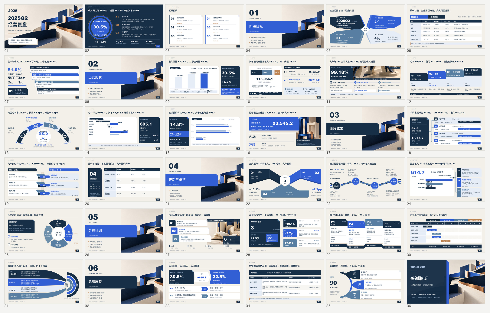
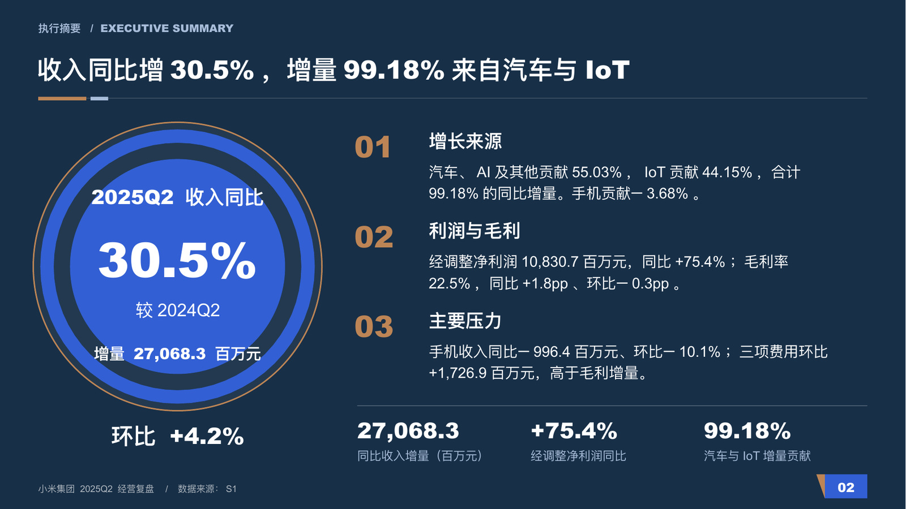
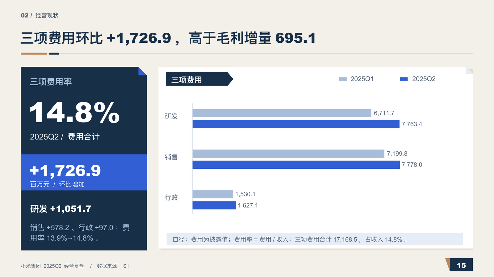
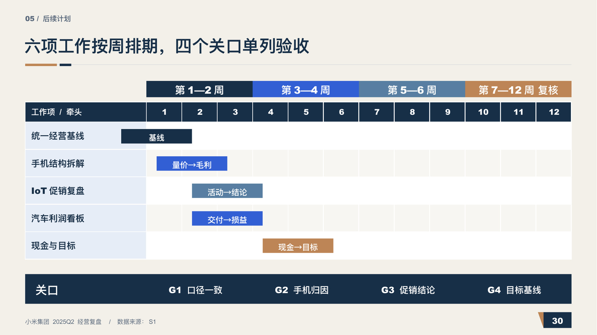
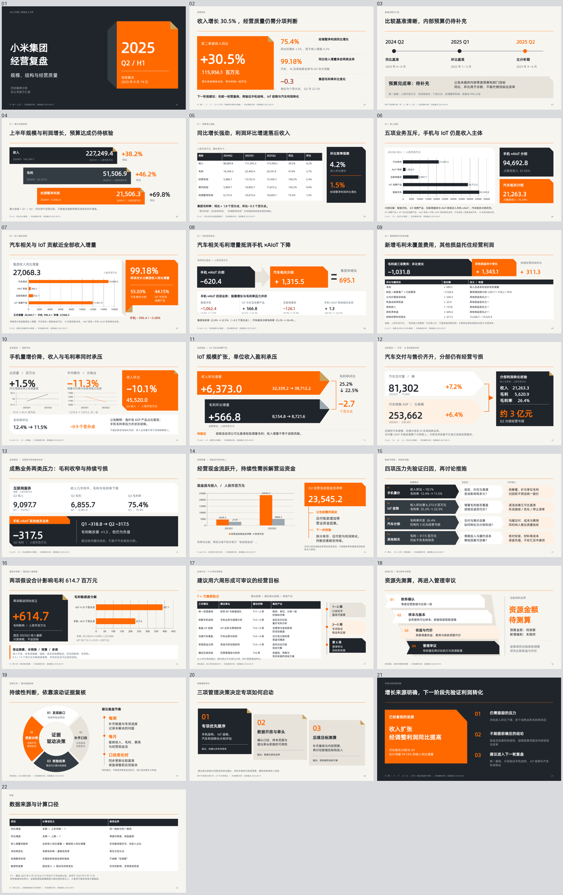
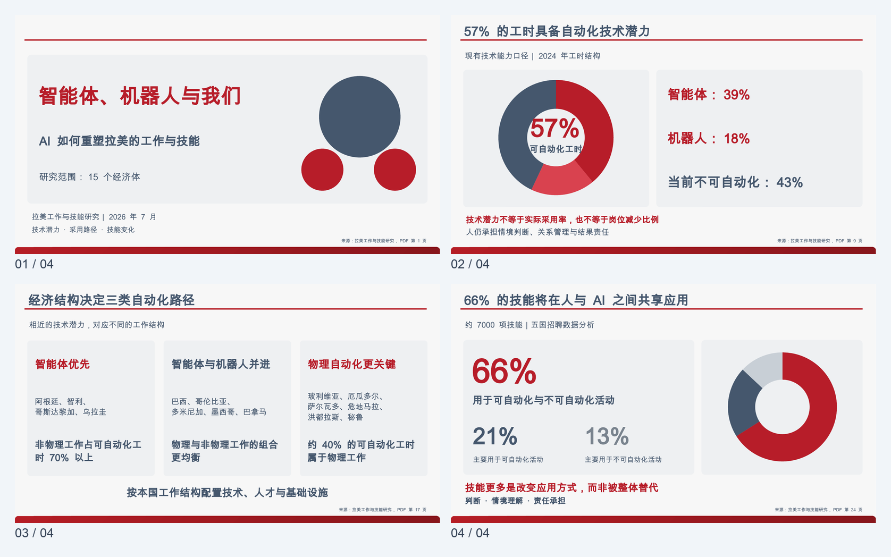
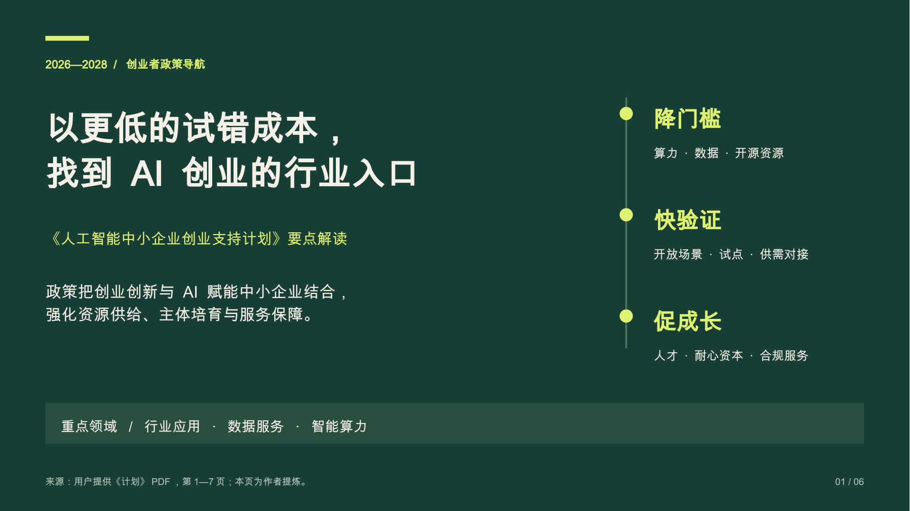

# PPT Smith

<p>
  <a href="https://ppt.skillmelody.com"></a>
  <a href="https://chromewebstore.google.com/detail/ppt-smith-%C2%B7-source-basket/ndmjfdmpgghcgpbidcloljomlmkfngab"></a>
  <a href="https://www.youtube.com/watch?v=_I2oauMIwnM"></a>
  <a href="SKILL.md"></a>
  <a href="LICENSE"></a>
</p>

[English](README.en.md) · [在线网站](https://ppt.skillmelody.com) · [Chrome 插件](https://chromewebstore.google.com/detail/ppt-smith-%C2%B7-source-basket/ndmjfdmpgghcgpbidcloljomlmkfngab) · [演示视频](https://www.youtube.com/watch?v=_I2oauMIwnM) · [Skill 入口](SKILL.md) · [安装与自检](#安装与本地自检) · [联系与反馈](#联系与反馈)

**把源文档、网页摘录、设计图或原生 PPTX 模板，转成有来源、可继续修改、具有真实渲染预览的演示文稿。**  
模型负责理解内容与设计，固定工具负责生成、编辑与核验。

> **当前版本：`5.4.0` · Apache-2.0。** 安装标识 `article-html-to-ppt`，公开标识 `meowclaw-pptsmith`，兼容别名 `meowclaw-decksmith`。

---

## 三种使用入口：从网页收集到可编辑 PPT

| 入口                          | 适合谁                                                | 核心能力                                                                | 访问地址                                                                                                                                                                                |
|:--------------------------- |:-------------------------------------------------- |:------------------------------------------------------------------- |:----------------------------------------------------------------------------------------------------------------------------------------------------------------------------------- |
| **🌐 在线网站**                 | 想免配置直接生成 PPT 的用户                                   | 无需安装本地环境；支持上传资料或承接插件资料篮，精选模板库 / 上传自有 PPTX 模板，确认大纲后生成可编辑演示文稿         | [ppt.skillmelody.com](https://ppt.skillmelody.com)                                                                                                                                  |
| **🧩 浏览器插件（Source Basket）** | 日常边浏览边攒素材做汇报的用户                                    | 整页收集（含微信公众号文章）、右键摘录文字、自由框选海报/图表截图；数据默认**仅存本机**，可导出 ZIP 资料包或一键带入网站生成 | [Chrome Web Store](https://chromewebstore.google.com/detail/ppt-smith-%C2%B7-source-basket/ndmjfdmpgghcgpbidcloljomlmkfngab) · [离线 ZIP 0.1.5](pptsmith-browser-extension-0.1.5.zip) |
| **⚙️ 开源 Agent Skill（本仓库）**  | 使用 Claude Code / Codex / OpenClaw 等 Agent 的进阶用户与团队 | 本地全流程可审计：HTML 设计面编译原生 PPTX、行业与品牌风格提取、原页克隆模板编辑、整册结构诊断与实机渲染审核         | [SKILL.md](SKILL.md) · [安装与自检](#安装与本地自检)                                                                                                                                            |

---

## 插件与网站联动演示（PPT Smith · Source Basket）

点击下方封面前往 YouTube 观看 **37 秒实拍演示**（从网页划词摘录、框选海报截图，到导出本地 ZIP 资料包或一键带入 `ppt.skillmelody.com` 选模板生成）：

[](https://www.youtube.com/watch?v=_I2oauMIwnM)

- **三种网页收集方式**：点击「收集本页」抓取整篇文章（已修复微信公众号侧栏收集）、选中文本右键加入资料篮、自由框选网页海报或图表截图。
- **本地优先，隐私可控**：所有整理与 ZIP 导出均在本机完成；在你主动点击「带入网站生成」前，资料仅存本机。
- **两条无缝出口**：
  - **导出资料包（ZIP）**：打包结构化 Markdown 摘录与截图，直接交给本地 Agent + PPT Smith Skill 溯源生成。
  - **带入网站生成**：一键将文字与截图送入 [ppt.skillmelody.com](https://ppt.skillmelody.com)，可选择**使用模板**（官方/精选模板或上传自有 PPTX）或**内容生成**（确认大纲后生成）。
- **安装与升级**：Chrome 用户推荐直接从 [Chrome 应用商店安装](https://chromewebstore.google.com/detail/ppt-smith-%C2%B7-source-basket/ndmjfdmpgghcgpbidcloljomlmkfngab)；Edge 或离线环境可下载仓库中的 [pptsmith-browser-extension-0.1.5.zip](pptsmith-browser-extension-0.1.5.zip)（升级时解压覆盖原插件目录并在扩展管理页点击「重新加载」，即可保留本机资料篮）。

---

## 作品展示

### 模板路线实测｜小米集团 2025Q2 及上半年经营复盘 · 36 页

从经营摘要、收入与利润拆解，到问题验证、行动排期与管理层决策，保留统一模板语言和完整汇报结构。下图直接来自用户提供成稿的真实办公渲染，不是宣传重绘图；点击可看完整总览。

[](assets/samples/v5.3-xiaomi-2025-q2-h1-template-36page-overview.jpg)

<table>
  <tr>
    <td width="33%"><a href="assets/samples/v5.3-xiaomi-template-page-02.jpg"></a><br><strong>结论摘要</strong> · 指标与判断分层</td>
    <td width="33%"><a href="assets/samples/v5.3-xiaomi-template-page-15.jpg"></a><br><strong>费用对比</strong> · 数据与解释归组</td>
    <td width="33%"><a href="assets/samples/v5.3-xiaomi-template-page-30.jpg"></a><br><strong>行动排期</strong> · 从判断走向执行</td>
  </tr>
</table>

<details>
<summary>查看这份作品的对象统计与验证范围</summary>

- 实际 **36 页、16:9，36 页备注正文齐全**；本次 LibreOffice 渲染 **36/36 页通过**。
- 顶层对象 1,398 个：1,383 个原生形状（其中 772 个含非空文本），4 个原生表格、11 个图片对象。文本框是形状的子集，不重复相加。
- 本稿**没有原生数据图表或图表内嵌工作簿**；可视条形、圆环等由原生图形表达，不能冒称可编辑图表数据。
- 这是用户提供的模板路线成稿。本轮完成文件核对、真实渲染和代表页目检，**未重新执行其完整生成过程**，不据此标注为本轮 5.3.0 端到端生成认证。
- 原稿局部换行和标注间距问题保留，未为展示重新排版。未复核全部财务事实，PowerPoint/WPS 编辑保存重开未测。
- 仅公开总览、三张代表页及[简要证据](assets/samples/v5.3-xiaomi-template-evidence.json)，不公开原始 PPTX、资料与完整日志。

</details>

### 更多真实作品

<table>
  <tr>
    <td width="33%"><a href="assets/samples/v5.2-xiaomi-q2-h1-22page-overview.png"></a><br><strong>22 页装饰商务汇报</strong><br>正文构图变化与整册一致性</td>
    <td width="33%"><a href="assets/samples/v5.1-template-native-4page-2col-overview.png"></a><br><strong>4 页原生组件复用</strong><br>与模板风格重建设计作同源对照</td>
    <td width="33%"><a href="assets/samples/v5.1-no-image-policy-page-01.png"></a><br><strong>6 页无生图政策解读</strong><br>原生对象设计与实际预览</td>
  </tr>
</table>

历史作品保留原版本与原验证范围，详见[历史画廊与实测说明](references/cases/legacy-showcase.md)。作品数量、对象数量和本轮版本号都不直接代表审美质量或通用兼容性。

---

## 核心特性：5.4.0 HTML 设计面与整册质检护栏

- **在浏览器里排版，交付 100% 原生对象**：`create` 默认采用受限 HTML/CSS 设计面，借助无头浏览器的真实 Flex/Grid 布局与文字测量完成构图；`engine design html-import` 用固定提取器编译为可编辑的文字、形状、自由曲线、原生表格、原生图表与可替换图片（`data-asset`）。HTML 不进入 PPTX，页面脚本与外部资源一律拒绝。
- **行业适配 + 品牌特征自动提取**：按内容所属行业与受众定制视觉语言，不再千篇一律套同一套模板；当源材料包含明确品牌主体（如咨询研报、企业财报、产品方案）且用户未要求换风时，主动从源文档封面、图表与版式提取品牌视觉特征，同时严禁伪造未提供的官方 Logo。
- **内容溯源不靠自觉**：导入时自动生成内容记录与来源，逐项核对上屏文字、表格单元格与图表原始数值是否出自原文；模型撰写的标题、计算值与导航标记须分别声明，原文遗漏数字给出覆盖报告。
- **硬拦截 + 整册结构诊断**：
  - `design_lint` 在导入期直接拦截文字重叠、超出卡片、固定框溢出、出界、中文缺字体、层级过平，以及**单值轴图表混放异量纲（`CHART_MIXED_UNITS`，如 GW 与 % 共轴）**；
  - `composition-check` 自动诊断整册叙事结构：**章扉页底色不统一、目录首章漏起始页、目录章节数与扉页数不匹配、章扉页编号与正文眉标错位**；
  - 支持 `set-meta` / `set-page` / `add-page` / `remove-page` / `reorder-pages` 轻量修订，以及按页实际字体判定的 `preflight` 预检。
- **5.3.0 原页克隆模板工作流**：绑定真实源页，保留母版、主题与原生关系；通过固定 Python 工具原子更新文字、图表/表格数据、页序与备注，失败不留半成品，未选原页不夹带进入输出包。

---

## Skill 三种制作路线

| 你要完成的事                   | 输入              | 路线                                    |
|:------------------------ |:--------------- |:------------------------------------- |
| 从报告、政策、PRD、文章、资料篮或数据制作演示 | 源材料；可选品牌或风格参考   | **create**：默认走 HTML 设计面编译原生页面，再渲染与审核  |
| 重建已经批准的完整幻灯片设计           | 整页设计图；核对文字数字的材料 | **recreate**：原生重建并对照冻结目标              |
| 保留公司或客户的 PPTX 模板         | 原生模板与本次内容       | **template**：原页克隆编辑；复杂组件任务保留 Atlas 流程 |

模板只作风格参考、允许重新设计时用 `create`；必须保留原生页面与模板资产时才用 `template`。资料页数不决定演示页数，长报告须按内容体量合理规划页数，避免硬压页数或合并并列大章。

**没有生图工具也能设计。** 具备视觉理解的模型可以编写原生对象、查看实际渲染并修订；生图仅作为独立插画或经批准外部设计目标的可选能力。只有文本模型时，图像理解与独立视觉审核仍需视觉模型或人工。

---

## 怎么用：把目标交给 Agent

加载 [SKILL.md](SKILL.md)，提供材料（文档、大纲或插件导出的资料包 ZIP），说明受众、目的、语言、页数和目标软件。普通用户无需编写 JSON 或 HTML。

**从资料原创设计（默认 HTML 设计面）：**

```text
使用 PPT Smith，将这份材料做成面向管理层的中文可编辑 PPT。
结论先行，按报告所属行业与品牌特征定调，正文构图随信息关系变化，章节编号全册统一。
不编造缺失数字，区分原文事实、计算与作者建议；逐页保留来源和备注。
不要求生图。交付实际 PPTX、预览、审核结论和重要编辑限制。
```

**使用原生公司模板：**

```text
使用 PPT Smith，基于这个公司 PPTX 模板和附件经营材料，制作约 20 页中文汇报。
面向管理层，先给核心结论，再解释变化和待决事项。
保留原页视觉语言、母版与布局；按内容选择、复制和调整页面，不照抄模板示例文案。
保留关键数字、口径、来源与讲稿。先做代表页，再完成整稿；
真实渲染后独立审核，说明图表、图片和目标软件的编辑边界。
```

**还原或修订：**提交已批准的完整设计图并注明需忠实还原；只改少量内容时保留任务目录，指出页/对象和改动。两条路线都只通过 `review-template --inherit-from` 显式继承完全未变且已通过的单页观察，改动页与整册节奏必须重新审核，绝不自动沿用旧候选结论。

---

## 安装与本地自检

在 Skill 根目录安装依赖（macOS / Linux Bash 示例）：

```bash
python3 -m venv .venv
source .venv/bin/activate
python -m pip install -r requirements.txt
python scripts/check_identity.py
python scripts/quick_validate_skill.py
python -m engine design capabilities
python -m engine template capabilities
```

真实预览与 HTML 设计面需要本机安装 **LibreOffice、Poppler、Fontconfig、实际字体及 Chrome / Chromium Headless Shell**（可用 `PPTSMITH_BROWSER` 指定浏览器路径）。`capabilities` 检查本地工具，不自动识别宿主模型的识图或生图能力。

- 新原页模板执行器要求 **POSIX `fcntl` + `O_NOFOLLOW`**，本机 macOS 已验证，Windows 不支持；源模板与输出各最多 100 页。
- `create` / `recreate` 的跨平台运行条件见[声明式工作流](references/declarative-design.md)。
- 仅使用依赖 PptxGenJS 的兼容构建器时，另需 Node/npm 和 `python scripts/bootstrap_pptxgenjs_runtime.py`。默认 HTML 与原页模板路线均无需新增 Node 依赖。

---

## 交付与兼容边界

| 项目      | 当前边界                                                  |
|:------- |:----------------------------------------------------- |
| 新原生图表编辑 | 单 plot 类别图，真实数据与内嵌工作簿；单值轴禁止混放不同量纲                     |
| 表格      | HTML 路线支持合并单元格与逐格样式；原页模板路线仅编辑既有未合并矩形单元格               |
| 图片      | HTML 路线支持已登记素材（`data-asset`）可替换嵌入；原页模板路线仅复制同源嵌入图片     |
| 样式与保真   | 源资产保留、构图诊断与字号底线是证据辅助，不能冒充审美评分                         |
| 审核      | 绑定当前候选、源模板与实际页图；审核者身份仅声明，不认证                          |
| 办公软件    | 原生对象与 LibreOffice 渲染不等于 PowerPoint / WPS GUI 编辑保存重开通过 |

正式交付应包含可编辑 PPTX、实际预览、来源/缺项、审核结论与编辑限制。未经批准的整页截图不能充当可编辑重建；经营或科研事实仍须核对。源材料如何进入模型取决于宿主配置，本地工具不代表模型调用一定离线。

质量与 OS 隔离分别验证，显式的隔离要求不得降级。Bespoke 仍为高级兼容路线，Standard/Engineering 仅用于明确的工程草稿和诊断。

---

## 文档与分发

- **核心规范**：[Skill 执行规范](SKILL.md) · [HTML 设计面指南](references/html-design-authoring.md) · [原页编辑式模板流程](references/native-template-workflow.md)
- **设计与输入**：[声明式设计与验收](references/declarative-design.md) · [紧凑输入与局部修订](references/declarative-authoring.md) · [无附件逐页稿制作](references/outline-to-deck.md)
- **进阶构图与模板**：[装饰商务设计](references/decorative-business-design.md) · [页面规划表](templates/decorative-page-plan.md) · [模板风格参考](references/template-visual-design.md) · [已有模板组件流程](references/routes/v4-template-route.md)
- **证据与打包**：[历史作品与验证范围](references/cases/legacy-showcase.md) · [分发范围说明](references/BUNDLE-MANIFEST.md)

GitHub 仓库（[SkillMelody/PPT-Smith](https://github.com/SkillMelody/PPT-Smith)）保存源码、展示样张、离线插件包与聚焦回归；ClawHub / SkillHub 轻量运行包通过 `.clawhubignore` 排除测试、插件压缩包、`assets/samples/`、`assets/branding/` 与私有材料。

---

## 联系与反馈

如果你在网站、浏览器插件或 Agent Skill 使用过程中觉得效果不对劲、流程卡壳，先别急——很多时候只是「使用姿势不对」（我们对各类使用问题、提示词写法与流程踩坑的专属简称）。

无论是排查使用姿势不对、反馈 Bug、提出功能建议，还是洽谈企业模板与定制合作，都欢迎通过以下渠道找到我们：

- **邮箱**：[melody@skillmelody.com](mailto:melody@skillmelody.com)
- **GitHub Issues**：[SkillMelody/PPT-Smith/issues](https://github.com/SkillMelody/PPT-Smith/issues)（适合提交可复现的报错、构建日志与「使用姿势不对」案例）
- **微信公众号**：搜索「夜猫子弦月」（版本动态、实战拆解与留言互动）
- **知乎**：官方专栏与问答交流（欢迎关注私信或评论区反馈使用姿势问题）
- **X (Twitter)**：产品更新与海外交流动态

由 **MeowClaw Lab / SkillMelody** 维护。核心引擎、通用组件与 QA 采用 **Apache-2.0**；品牌与样例不表示与相关公司存在合作或背书。企业品牌适配、专属母版及代生成等商业交付不包含在公共包内。
